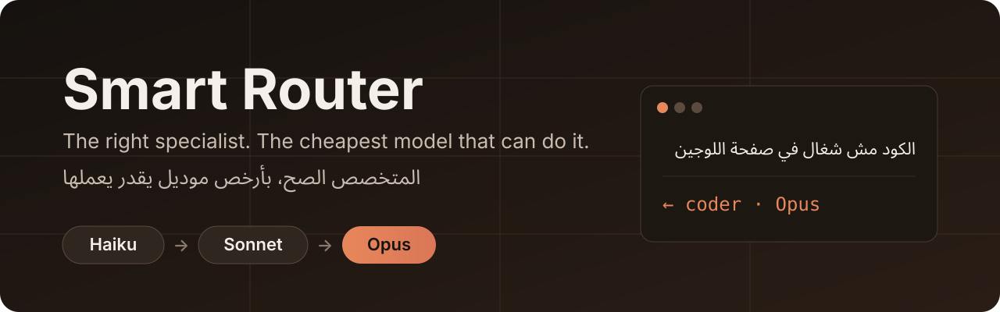

<p align="center">
  
</p>

<p align="center">
  <a href="https://github.com/ahmedsykoo/smart-router/actions/workflows/check.yml"></a>
  <a href="LICENSE"></a>
  
  
</p>

<p align="center">
  <a href="#quick-start--البداية-السريعة">Quick start</a> ·
  <a href="#how-it-works--بيشتغل-إزاي">How it works</a> ·
  <a href="#the-16-specialists--المتخصصين">Specialists</a> ·
  <a href="#setup--الإعداد">Setup</a> ·
  <a href="#customize--التخصيص">Customize</a>
</p>

A rules file + Claude skill that routes every message to **one of 16 specialists** and **the cheapest model tier that can do it**.
It runs a **real check** on the result, **escalates once** on failure, and ends each reply with a footer like `← coder · Sonnet`.

<p dir="rtl">راوتر لـClaude بيختار لكل رسالة المتخصص المناسب وأرخص موديل يقدر يعملها، ويتأكد من النتيجة بتشيك حقيقي. الكلمات المفتاحية بالمصري الأول.</p>

| Message | Routed to |
|---|---|
| <span dir="rtl">اعملي ريل 30 ثانية عن المنتج</span> | `← reels-maker · Sonnet` |
| <span dir="rtl">الكود مش شغال في صفحة اللوجين</span> | `← coder · Opus` |
| <span dir="rtl">السلام عليكم</span> | `← chat · Haiku` |
| `!opus` <span dir="rtl">اكتبلي بوست عن الذكاء الاصطناعي</span> | `← content-writer · Opus` |

## Quick start / البداية السريعة

<p dir="rtl">خطوتين وتشتغل، من غير ما تعدّل أي حاجة.</p>

**claude.ai**
1. Add [`router-rules.md`](router-rules.md) to a Project's files.
2. Put this line in the Project instructions:
   ```text
   Follow router-rules.md (in the project files) for EVERY message, including greetings.
   ```

**Claude Code**
1. Copy [`router-rules.md`](router-rules.md) into your repo's `CLAUDE.md` (or reference it from `.claude/`).
2. Run the session on **Sonnet** (`/model sonnet`). The router does Sonnet work inline and only spawns subagents for Opus and Haiku; on Opus, every message costs Opus just to route.

Optional extras (profile, logging, voice) are in [Setup](#setup--الإعداد).

## Why / ليه

<p dir="rtl">الموديل الغالي بس للحاجات اللي محتاجاه، ومفيش "خلصت" من غير تشيك حقيقي.</p>

- **Cost:** Haiku for greetings and quick questions, Sonnet for normal work, Opus only for design, debugging, review and big projects.
- **Real checks:** a subagent saying `STATUS: DONE` isn't enough when a command can prove it.
- **Arabic-first:** keyword tables are written in the dialect people actually type (`مش شغال`، `اعملّي`، `لخصلي`).
- **Content too, not only code:** voice, reels, motion, video editing, social design and writing have their own specialists.

## How it works / بيشتغل إزاي

<p dir="rtl">كل رسالة بتعدّي على نفس الخطوات: يختار الموديل والمتخصص، ينفّذ، يتشيك على النتيجة، يصعّد مرة لو فشل، ويحط الفوتر.</p>

| Step | What happens |
|---|---|
| 0. Answer mode | A question, opinion or comparison with nothing to produce → answer inline on Sonnet (Haiku if trivial), then step 6. |
| 1. Tier | `!opus` / `!sonnet` / `!haiku` prefix → else any Opus keyword → else any Haiku keyword. |
| 2. Specialist | Walk the specialists table top to bottom; first keyword match wins. No match → `general`. |
| 3. Model | `manual \|\| Opus/Haiku keyword \|\| specialist default \|\| sonnet` |
| 4. Execute | Pick a `done_check` first. Same model as the router → do it inline; otherwise spawn one subagent with the brief + contract (`STATUS: DONE / UNSURE / FAILED`). Then run the check. |
| 5. Escalate once | `UNSURE`, `FAILED` or a failed check → retry one level up (`haiku → sonnet → opus`), once. |
| 6. Footer + log | `← <specialist> · <Model>` (e.g. `← coder · Haiku ↑ Sonnet`), then log the task if logging is set up. |

**What `done_check` runs per deliverable:**

| Deliverable | `done_check` |
|---|---|
| Code | the project's build / test / lint command |
| Video / reel | `ffprobe`: duration, size, audio stream |
| Image | file exists at the requested size |
| JSON / YAML | parses |
| Writing / research | no command; relies on `STATUS` |

## The 16 specialists / المتخصصين

<p dir="rtl">الترتيب مهم: أول متخصص كلمته تطابق الرسالة هو اللي بياخدها.</p>

| # | Name | Default | What it does |
|---|---|---|---|
| 1 | `voice` | Haiku | Text → speech in your cloned voice (Chatterbox Multilingual, Arabic) |
| 2 | `motion-designer` | Sonnet | Motion graphics and animation with HyperFrames, rendered MP4 |
| 3 | `reels-maker` | Sonnet | End-to-end 9:16 reels: script → visuals → voice → edit → captions |
| 4 | `script-writer` | Sonnet | Video scripts as a table: time, visual, voiceover, on-screen text |
| 5 | `video-editor` | Sonnet | Cut, merge, subtitles, audio sync with FFmpeg |
| 6 | `social-designer` | Sonnet | Posts, carousels, banners, thumbnails (HTML/CSS → PNG) |
| 7 | `content-writer` | Sonnet | Posts, captions, articles, LinkedIn, threads |
| 8 | `ui-designer` | Sonnet | Screens, landing pages, mockups, RTL-first |
| 9 | `skill-builder` | Opus | New Claude skills, subagent briefs, plugins, new router specialists |
| 10 | `automation` | Sonnet | n8n workflows, agents, webhooks, MCP servers |
| 11 | `reviewer` | Opus | Code and security review, tests, findings by severity |
| 12 | `project` | Opus | Multi-module builds: `.router/PLAN.md` (contracts first) → tasks per tier → `.router/PROGRESS.md` |
| 13 | `architect` | Opus | System design, data models, stack choices, hard debugging |
| 14 | `researcher` | Sonnet | Web and repo research with sources, license and Arabic-support flags |
| 15 | `coder` | Sonnet | Writes and fixes code, complete files |
| 16 | `chat` | Haiku | Greetings and small talk; says `UNSURE` if it turns into real work |

## Setup / الإعداد

<p dir="rtl">كله اختياري. اللي متعبّاش بيتخطاه الراوتر لوحده.</p>

- **Profile:** fill in the **EDIT ME — your profile** block in Part 3 (name, stack, reply language) so answers fit you.
- **Logging:** make an Artifact with the `db` capability and paste its URL in step 6 to log every task with its specialist and model.
- **Voice:** see below.

<details>
<summary><b>Voice setup</b>: clone your own voice for Arabic TTS</summary>

1. Install the skill so Claude has the voice files:
   - claude.ai: upload [`skills/smart-router/`](skills/smart-router/SKILL.md) in Settings → Capabilities → Skills.
   - Claude Code: `cp -r skills/smart-router ~/.claude/skills/`

   With `router-rules.md` already loaded, the skill loads only for voice tasks, so the rules aren't loaded twice.
2. Record `my_ref.wav`: 10–20 seconds of your voice, clean, no music.
3. Run it:
   - **Colab (no setup):** open [`colab.ipynb`](skills/smart-router/voice/colab.ipynb) → Runtime: T4 GPU → run the cells, upload `my_ref.wav` + `lines.txt` (one sentence per line). You get `out/all.wav`.
   - **Your own machine:** see the usage line at the top of [`clone.py`](skills/smart-router/voice/clone.py) (Python 3.11; the first install downloads ~2 GB). Claude runs it for you only if it has a remote-device tool (`mcp__remote-devices__device_bash`, Windows `py -3.11`); otherwise it sends you the Colab notebook.

The model's Arabic is closer to MSA, so tashkeel on tricky words helps. Only clone your own voice or one whose owner gave permission.

</details>

## Customize / التخصيص

<p dir="rtl">عدّل في <code>SKILL.md</code> بس، وبعدين شغّل <code>python check.py --sync</code>.</p>

- **Source of truth:** edit `skills/smart-router/SKILL.md` only. `python check.py --sync` regenerates `router-rules.md` and runs the routing tests; CI fails if the two files drift.
- **Keywords:** edit the tables in Part 2. Arabic = substring match, English = whole word. Prefer phrases over short roots (`ترجملي`, not `ترجم`, which also catches `ترجمة فيديو`).
- **Tests:** add a row to [`tests.md`](tests.md) (message → specialist → model) whenever you change keywords or hit a misroute.
- **New specialist:** write a brief in Part 3 (`## name — Model` + a few lines) and add a row to the Specialists table in Part 2 at the right position (more specific rows go higher).

Hit a misroute? [Open a misroute report](https://github.com/ahmedsykoo/smart-router/issues/new?template=misroute.yml) with the message and where it should have gone.

## Known limits / حدود معروفة

<p dir="rtl">الكلمات المفتاحية ممكن تفوّت مرادف، ووقتها استخدم <code>!opus</code> أو <code>!sonnet</code> أو <code>!haiku</code>.</p>

- Keyword matching is brittle: a missing synonym routes to the wrong specialist or `general`. Prefix `!opus` / `!sonnet` / `!haiku` to force a model.
- `done_check` only exists for deliverables with a command; writing and research rely on the subagent's `STATUS`.
- Voice cloning: only your own voice or one whose owner gave permission. No voice sample is shipped (`*.wav` is git-ignored).

<details>
<summary><b>Compared to smart-task-router</b></summary>

[celiktech24-cell/smart-task-router](https://github.com/celiktech24-cell/smart-task-router) is a good project with a different design; I took ideas from it (tier table, plan/verify), not code.

| | Smart Router (this) | smart-task-router |
|---|---|---|
| Routing | Keyword tables per message (cheap, predictable, editable) | Claude judges the tier per subtask from a spec / plan |
| Language | Egyptian Arabic + English keywords | English |
| Scope | Code **and** content: voice, reels, motion, video, social design | Coding tasks and code projects |
| Big code projects | `project` specialist: plan → per-task tier → check → progress file | Fuller pipeline: Haiku recon, Opus plan, per-task commits, Opus diff review |
| Effort control | Model only | Model + effort via agent files (Claude Code) |
| Verification | Real `done_check` per deliverable, escalate once | Real check per task, escalate on fail, re-plan after 2 Opus fails |

</details>

## Files / الملفات

```text
skills/smart-router/SKILL.md    the full rules as a Claude skill (source of truth)
router-rules.md                 same rules, generated by check.py --sync
check.py                        sync check + keyword routing tests
tests.md                        routing test cases
skills/smart-router/voice/      clone.py + colab.ipynb (Chatterbox TTS)
assets/                         README banner + signature
LICENSE                         MIT
```

## License / الرخصة

[MIT](LICENSE) © 2026 Ahmed Ramadan Mahmoud

<p align="center">
  <a href="https://github.com/ahmedsykoo"></a>
</p>
